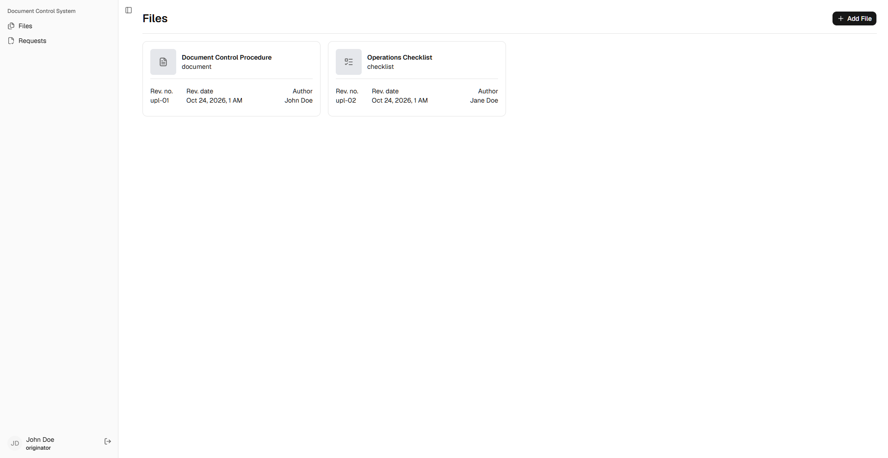

A web-based application designed to centralize document management, revision requests, approval workflows, and document publishing.

  <a href="./docs/setup-guide.md">Setup Guide</a>

 
 
## Features

### Document Management

- Create and submit document upload requests.

- Submit revision requests on existing documents.

- Submit document deletion requests.

- Resubmit document requests when required.

- Maintain document versions and associated files.

- Publish approved documents.

- Track document and request statuses.

### Approval Workflow

- Support role-based access for different participants in the document approval process.

- Route requests through the applicable review and approval stages.

- Record approval decisions and associated request information.

- Support approval, rejection, and resubmission workflows.

- Notify relevant users about applicable workflow events.

### Document Editing

- Integrate ONLYOFFICE Docs for browser-based document editing.

- Allow supported documents to be opened through the application.

- Save edited document versions through the backend.

- Keep document files associated with their respective records and versions.

## Technology Stack

| Component           | Technology                                     |
| ------------------- | ---------------------------------------------- |
| Frontend            | React, TypeScript, React Router Framework Mode |
| Frontend web server | Nginx                                          |
| Backend             | Laravel 12, PHP                                |
| Database            | MySQL 8.4                                      |
| Document editor     | ONLYOFFICE Docs Server                         |
| Email notifications | Laravel Mail and Resend                        |
| Containerization    | Docker                                         |

> This project was developed as part of an On-the-Job Training (OJT) / internship at Toyota Santa Rosa. It was designed to address specific internal document control needs identified during the internship and is intended solely for its original purpose within the organization. It is not intended for commercial distribution or as an official Toyota product.
